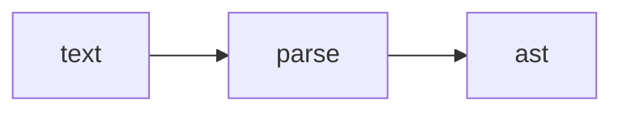

# ForgeLS - Agent Rules

ForgeLS is a Language Server Protocol (LSP) for smart contract languages such as Solidity, Noir, and others. It is built in Rust as a workspace monorepo with small focused crates.

Read this file before any code change. Keep all changes consistent with the architecture below.

## 1. Workspace Architecture

We split by function and by language. Shared code is reusable. Language code is independent.

```text
forgels/
  Cargo.toml                  # virtual workspace, members = crates/*
  crates/
    fls/                      # sole entrypoint: lsp server plus check linter
    forgels-core/             # server lifecycle, workspace manager, config, diagnostics hub
    forgels-protocol/         # LSP and JSON-RPC types only, no language logic
    forgels-syntax/           # shared AST, lexer, parser toolkit reused by all languages
    forgels-common/           # shared utils any crate may use: fs, paths, logging, http
    forgels-lang-solidity/    # solidity only: ast, lexer, parser, analysis
    forgels-lang-noir/        # noir only: ast, lexer, parser, analysis
  docs/
  .caches/
```

### 1.1 Shared crates

- `forgels-core`: owns orchestration across languages. No language grammar here. It dispatches to `forgels-lang-*`.
- `forgels-protocol`: owns protocol types such as `Position`, `Range`, `Diagnostic`, `Request`, `Response`. No analysis here.
- `forgels-syntax`: reusable syntax foundation. It provides `Span`, `Token`, `Lexer` trait, `Parser` trait, `SyntaxNode`, `SyntaxToken`, `AstNode`, `Visitor`, `ParseError`. It must stay language agnostic. No Solidity or Noir grammar here.
- `forgels-common`: small helpers for fs, paths, logging, and http client. Any crate may use this.
- `fls` (binary): sole entrypoint. It serves `lsp` on stdio plus `check` lint, loads `Config`, starts `Server` from `forgels-core`, and routes by file extension or language id.

### 1.2 Language crates

Each language crate is self contained for grammar and analysis:

- Naming: `forgels-lang-<name>` in lowercase, for example `forgels-lang-solidity`, `forgels-lang-noir`, `forgels-lang-cairo`.
- Standard modules inside each language crate:
  - `lib.rs`: exports `LANGUAGE_ID`, `FILE_EXTENSIONS`, plus `ast`, `lexer`, `parser`.
  - `ast.rs`: typed AST nodes built on `forgels-syntax::SyntaxNode` via `AstNode` trait.
  - `lexer.rs`: implements `forgels-syntax::Lexer`.
  - `parser.rs`: implements `forgels-syntax::Parser`.
  - Optional later: `analysis.rs`, `completion.rs`, `hover.rs`, `diagnostics.rs`.
- Each language defines its own `SyntaxKind`, nodes, and grammar. Reuse traits and types from `forgels-syntax`. Do not copy span, error, or visitor logic per language.

## 2. Dependency Rules (Strict)

1. Language crates are independent.
   - Allowed: `forgels-lang-solidity` may depend on `forgels-core`, `forgels-protocol`, `forgels-syntax`, `forgels-common`.
   - Forbidden: `forgels-lang-solidity` must NOT depend on `forgels-lang-noir` or any other `forgels-lang-*`. Same rule applies in reverse and for all future languages.
2. Shared crates must NOT depend on language crates.
   - `forgels-core`, `forgels-protocol`, `forgels-syntax`, `forgels-common` must never import `forgels-lang-*`.
3. `forgels-syntax` is the only place for reusable AST and parser abstractions. New shared syntax logic goes there, not inside a language crate.
4. `forgels-protocol` has zero language logic and ideally zero heavy deps. Keep it light.
5. The binary `fls` may depend on all crates to wire routing. Keep logic thin. Move logic to `forgels-core` or to the relevant language crate.
6. Add new shared deps via `[workspace.dependencies]` in root `Cargo.toml`, then reference with `*.workspace = true` in crate manifests. Do not pin versions per crate.

Check rule violations with:

```bash
cargo tree -p forgels-lang-solidity
cargo tree -p forgels-lang-noir
```

If a language appears in another language tree, reject the change.

## 3. How To Add A New Language

Example for Cairo:

1. Create `crates/forgels-lang-cairo/` with `Cargo.toml`, `src/lib.rs`, `src/ast.rs`, `src/lexer.rs`, `src/parser.rs`. Copy structure from `forgels-lang-noir`.
2. In `Cargo.toml`, depend only on shared crates plus workspace metadata.
3. Define `LANGUAGE_ID = "cairo"` and `FILE_EXTENSIONS = &["cairo"]`.
4. Implement `Lexer` and `Parser` from `forgels-syntax`. Build typed AST with `AstNode`.
5. Register the crate in root `Cargo.toml` members and `[workspace.dependencies]`.
6. Wire routing in `crates/fls/src/lsp.rs` or `forgels-core` workspace map by extension.
7. Add docs under `docs/lang-cairo.md` in English, short and direct.

## 4. Rust Workflow

Use these commands from repo root:

```bash
cargo check --workspace
cargo test --workspace
cargo fmt --all
cargo clippy --workspace -- -D warnings
cargo run -p fls -- lsp
```

Rules:

- Keep code in English. Comments short and direct.
- Run `cargo fmt` before commit. Keep `clippy` clean.
- Prefer traits from `forgels-syntax` over ad hoc parsing. Return `ParseError` with `Span`.
- All public types need explicit `Span` info for diagnostics and go to definition.
- No `unwrap` in server paths. Use `Result` and map errors to `forgels-protocol::Diagnostic`.

## 5. Folder Rules

### 5.1 Top level

- `.caches/`: local only cache for planning, eval, memory, or temp work. Never commit real work results as source of truth. Never store secrets here.
- `docs/`: official docs. Always English. See section 6.
- `crates/`: all Rust source. No loose `src/` at repo root. Root `Cargo.toml` is virtual workspace only.

### 5.2 `.caches/`

Fixed layout:

```text
.caches/
  plan/   # design notes, task plans, RFC drafts
  eval/   # test reports, benchmark notes, review results
  mem/    # durable memory for agents: decisions, context, open questions
  temp/   # scratch output, safe to delete
```

Rules:

- All file names must be lowercase. Use hyphens, not spaces. Example: `solidity-parser-plan.md`, `2026-10-15-hover-eval.md`.
- Format must be consistent: markdown with front matter block at top (`title`, `date`, `status`, `owner`).
- If the file is a note, use markdown. Use mermaid charts for flows, state, or architecture sketches.
- `temp/` is gitignored and may be deleted at any time. Do not link docs to `temp/`.
- `plan/`, `eval/`, `mem/` are commit optional and for local iteration. Promote final decisions to `docs/` in English.

Minimal note template:

```markdown
---
title: solidity parser plan
date: 2026-10-15
status: draft
owner: core-team
---

# Title

## Goal

## Plan



## Open questions
```

### 5.3 `docs/`

See section 6. Source of truth for architecture and language support.

## 6. Docs Rules (Strict)

- Language: always English.
- Style: direct and compact. Use effective sentences. Prefer bullets and code over prose.
- Forbidden: em dash. Never use it. Use hyphen `-` or colon `:` instead.
- Charset: use plain natural ASCII only. Avoid unicode symbols unknown to search keywords. Stick to basic punctuation, code ticks, and standard mermaid syntax.
- Each doc must state scope at top: what crate or language it covers.
- Keep docs close to code: update `docs/` in same PR as behavior change.

## 7. OpenCode Setup

Project uses OpenCode with local config in `opencode.json` and `.opencode/`.

- `opencode.json`: project instructions (`AGENTS.md`, `docs/architecture.md`, `docs/syntax-toolkit.md`), formatter on, skills allowed for all agents.
- Global MCP (inherited, do not duplicate): `context7` at `https://mcp.context7.com/mcp` for current library docs, `firecrawl` at `https://mcp.firecrawl.dev/v2/mcp` for web search, scrape, research, and developer index.
- Project MCP (`opencode.json`): `plane` at `https://mcp.plane.so/http/mcp` via OAuth for Plane Cloud work items, cycles, and projects. One connection binds one workspace. Auth once in browser, then use natural language prompts.
- Global skills (reuse, do not copy): `context7-mcp` for library docs via resolve then query, plus `firecrawl-search`, `firecrawl-scrape`, `firecrawl-developer-index`, `firecrawl-research-papers`, and other `firecrawl-*` for crawl, map, monitor, QA.

### 7.1 Agents (`mode: subagent`)

- `forgels-explorer`: explore only, no edits. Use first to gather files, current docs, upstream evidence, and unknowns. Output is an evidence pack for the planner.
- `forgels-planner`: plan only, no edits. Use after explorer for multi step work. Output goal, steps, files, verification, risks.
- `forgels-executor`: implements approved plan with small diffs. Loads `forgels-rust`, `forge-deslop`, `forgels-git` plus `context7-mcp` or `firecrawl-developer-index` when needed. Hands off to QA.
- `forgels-qa`: reviews diffs, runs `check`, `test`, `clippy`, `fmt --check`, enforces `forgels-rust` and `forge-deslop`. Verdict PASS or FAIL with evidence.

Invoke with `@forgels-explorer`, `@forgels-planner`, `@forgels-executor`, `@forgels-qa`, or let the primary agent delegate via Task.

Every code task runs the delivery workflow in section 8. Subagents own their step inside it.

### 7.2 Skills (project local)

- `forgels-git`: Conventional Commits `type(scope): subject`, one concern per commit, group relevant files only.
- `forgels-rust`: readable Rust, guard clause first, no redundancy, short ASCII comments, consistent style.
- `forge-deslop` (skill `forge-deslop`): writing hygiene against AI slop, with objective reason per pattern.

Load order for code tasks: `forgels-rust` + `forge-deslop`, then `forgels-git` for commits. Use `context7-mcp` for external API docs. Use `firecrawl-developer-index` or `firecrawl-search` for upstream issues and PR evidence.

## 8. Delivery Workflow (Strict)

Every code task follows these steps in order. Do not skip. Do not reorder.

1. Drain open PRs first. List PRs targeting `dev` with `gh pr list --base dev`. If any is still open, stop and wait for the merge. Never stack new work on an unmerged PR branch.
2. Plane first. Search Plane for a work item covering the task.
   - If found, move it to In Progress.
   - If missing, create one: `[type] short subject` name, full description (what, where, accept criteria), priority, plus the relevant parent or epic. Then move it to In Progress.
   - Link related items, never duplicate them. Never create `[pr]`-prefixed work items.
3. Branch from `dev`. One scope per branch: `feat/<slug>` for features, `fix/<slug>` for fixes, `chore/<slug>` for chores. Never commit directly to `dev` or `main`. One concern per commit with Conventional Commits.
4. Orchestrate subagents in order: `@forgels-explorer` to gather evidence (files, current docs, upstream, unknowns), `@forgels-planner` to turn findings into an approved plan, `@forgels-executor` to implement the plan with small diffs, `@forgels-qa` to gate every commit and PR. QA verdict must be PASS with evidence before proceeding.
5. Open a PR against `dev`, one PR per branch.
   - Read `.github/pull_request_template.md` first. Templates change, so check it every time, never paste from memory.
   - Fill every section with detail. Each paragraph covers one context only. State what changed, why, and how it was verified. No mixed topics per paragraph, no confusing prose.
   - A merged PR is reflected only by the parent task status, never by a `[pr]` work item.
6. After merge, move the Plane work item to Done and attach the PR link to it.
7. Recommend next work: pick from open Plane items first, else propose from your own analysis. State the item, why it matters, and the expected scope.

## 9. Agent Checklist Before Finish

1. `cargo check --workspace` passes.
2. No cross language import added.
3. New shared logic placed in `forgels-syntax`, `forgels-protocol`, `forgels-common`, or `forgels-core`, not in a language crate.
4. File names under `.caches/` are lowercase markdown if notes.
5. `docs/` edits are English, direct, ASCII only, with no em dash.
6. `forgels-qa` verdict is PASS with evidence attached.
