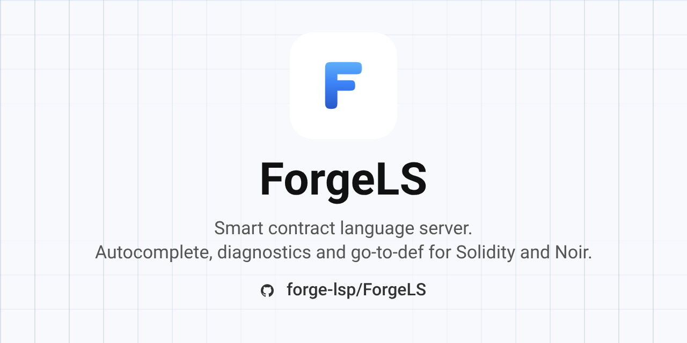

# ForgeLS



[](Cargo.toml)
[](docs/lsp-3.18-reference.md)

ForgeLS is a Language Server Protocol server for smart contract languages. It runs over stdio and currently supports Solidity, with architecture ready for Noir and other languages.

- Diagnostics with UTF-16 positions, debounced publish, clear on close.
- Hover, completion, and goto-definition for Solidity.
- Multi-root workspaces, strict LSP lifecycle, TOML config with log levels.

## Installation

Requires Rust stable with cargo.

```sh
cargo install --path crates/forgels
```

Or run from source:

```sh
cargo run -p forgels
```

The server speaks JSON-RPC over stdio. Point any generic LSP client at the `forgels` binary with language id `solidity` for `.sol` files.

## Configuration

Optional `forgels.toml` next to the binary working directory:

```toml
publish_delay_ms = 200
log_level = "warn"
```

Flags: `--log-level <error|warn|info|debug|trace>`. Flags win over the file. Missing or broken files fall back to defaults with a stderr warning.

## Documentation

- [Docs index](docs/readme.md): map of all official docs.
- [Architecture](docs/architecture.md): crate layout and dependency rules.
- [Syntax toolkit](docs/syntax-toolkit.md): shared AST, lexer, and parser base.
- [Solidity support](docs/lang-solidity.md): token and grammar status.
- [Noir support](docs/lang-noir.md): token and grammar status.
- [LSP 3.18 reference](docs/lsp-3.18-reference.md): protocol subset in use.

## Development

```sh
cargo check --workspace
cargo test --workspace
cargo fmt --all
cargo clippy --workspace -- -D warnings
```

Read [AGENTS.md](AGENTS.md) before changing code. It defines the workspace split, Plane-first workflow, and skill setup.

## Contributors

ForgeLS Contributors. See [AGENTS.md](AGENTS.md) for workflow, skills, and review gates.

## License

MIT OR Apache-2.0. See [Cargo.toml](Cargo.toml).
