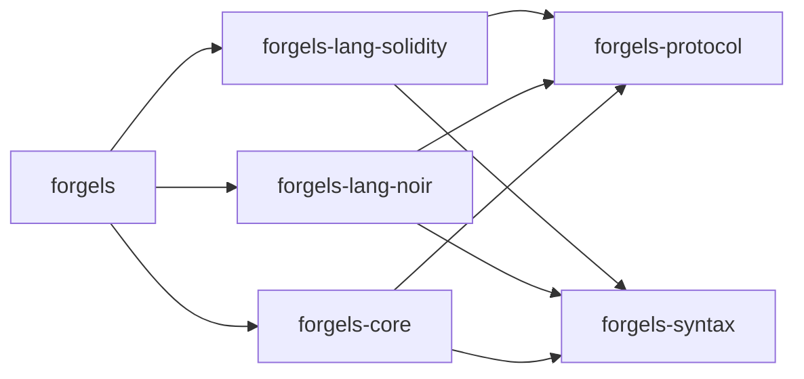

# Architecture

Scope: whole workspace. Defines crate layout and dependency rules.

## Layout

```text
crates/
  forgels/                # binary, thin routing only
  forgels-core/           # lifecycle, workspace, config, diagnostics
  forgels-protocol/       # LSP and RPC types
  forgels-syntax/         # shared AST and parser toolkit
  forgels-common/         # fs, paths, logging, http
  forgels-lang-solidity/  # solidity only
  forgels-lang-noir/      # noir only
```



## Dependency rules

- Language crates must not depend on other language crates.
- Shared crates must not depend on language crates.
- New shared syntax goes to `forgels-syntax`.
- New protocol types go to `forgels-protocol`.
- Binary wires routing only. Logic lives in `forgels-core` or language crates.
