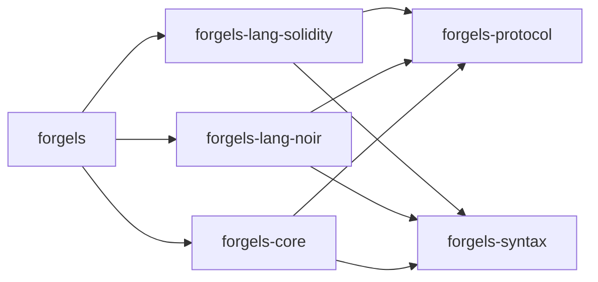
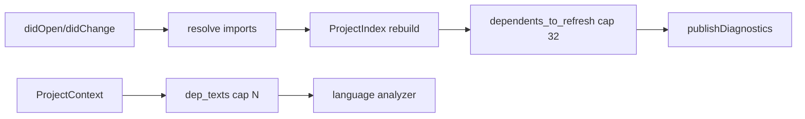

# Architecture

Scope: whole workspace. Defines crate layout and dependency rules.

## Layout

```text
crates/
  forgels/                # binary, thin routing only
  forgels-core/           # lifecycle, workspace, config, diagnostics
  forgels-protocol/       # LSP and RPC types
  forgels-syntax/         # shared AST and parser toolkit
  forgels-common/         # fs, paths, logging, http
  forgels-lang-solidity/  # solidity only
  forgels-lang-noir/      # noir only
```



## Dependency rules

- Language crates must not depend on other language crates.
- Shared crates must not depend on language crates.
- New shared syntax goes to `forgels-syntax`.
- New protocol types go to `forgels-protocol`.
- Binary wires routing only. Logic lives in `forgels-core` or language crates.

## Cross-file

- Graph: `forgels-core::index::ProjectIndex` keeps forward `files` edges and reverse `dependents` edges per open file. `rebuild_file` dedupes deps and fixes both directions.
- Update: `didOpen` and `didChange` run `refresh_index`, then `mark_dependents_dirty`. `didClose` drops the doc and marks dependents dirty so missing imports resurface.
- Context: `ProjectContext` carries `path`, `text`, `offset`, plus `workspace`. Helpers are `index()` and `file_text()`.
- Read: `dep_texts(ctx, cap)` returns transitive dep texts in index order. Tracked files only, deduped by path, cycle safe, capped by caller.
- Resolve: `resolve_import` accepts only `./` and `../`, lexical join next to the importer, no disk access. Bare, absolute, and empty specifiers return `None`.
- Remap: `resolve_with_remappings` tries relative first, then longest prefix match joined to root. Join is lexical only.
- Root: `resolve_root_for` picks owning workspace root, else config root, else importer parent.
- Fan-out: `dependents_to_refresh` filters `transitive_dependents` to tracked files. Cap is `MAX_DEPENDENT_REPUBLISH = 32`. Each target republishes with its own version.
- Symbol: `workspace_symbols(workspace, analyzers, query)` scans tracked files path-sorted, reuses `Analyzer::document_symbols` per file, flattens depth 0-1. Substring case-insensitive on name, empty query returns empty, caps at `MAX_WORKSPACE_SYMBOLS = 50` with early exit. Skips missing analyzers and out-of-bounds spans. Dispatch answers `workspace/symbol` with classic `SymbolInformation` and capability `workspaceSymbolProvider: true`.


