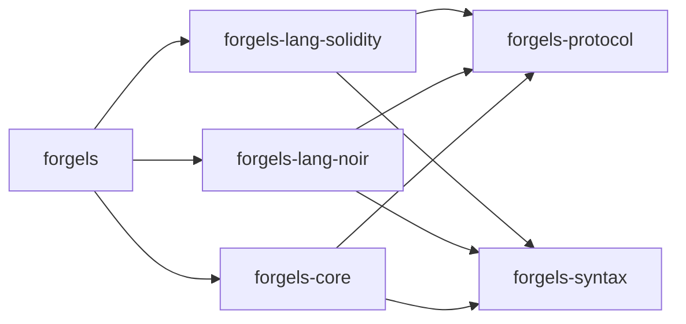
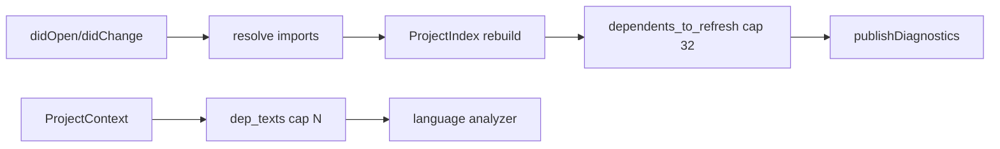

# Architecture

Scope: whole workspace. Defines crate layout and dependency rules.

## Layout

```text
crates/
  forgels/                # binary, thin routing only
  forgels-core/           # lifecycle, workspace, config, diagnostics
  forgels-protocol/       # LSP and RPC types
  forgels-syntax/         # shared AST and parser toolkit
  forgels-common/         # fs, paths, logging, http
  forgels-lang-solidity/  # solidity only
  forgels-lang-noir/      # noir only
```



## Dependency rules

- Language crates must not depend on other language crates.
- Shared crates must not depend on language crates.
- New shared syntax goes to `forgels-syntax`.
- New protocol types go to `forgels-protocol`.
- Binary wires routing only. Logic lives in `forgels-core` or language crates.

## Cross-file

- Graph: `forgels-core::index::ProjectIndex` keeps forward `files` edges and reverse `dependents` edges per open file. `rebuild_file` dedupes deps and fixes both directions.
- Update: `didOpen` and `didChange` run `refresh_index`, then `mark_dependents_dirty`. `didClose` drops the doc and marks dependents dirty so missing imports resurface.
- Context: `ProjectContext` carries `path`, `text`, `offset`, plus `workspace`. Helpers are `index()` and `file_text()`.
- Read: `dep_texts(ctx, cap)` returns transitive dep texts in index order. Tracked files only, deduped by path, cycle safe, capped by caller.
- Resolve: `resolve_import` accepts only `./` and `../`, lexical join next to the importer, no disk access. Bare, absolute, and empty specifiers return `None`.
- Remap: `resolve_with_remappings` tries relative first, then longest prefix match joined to root. Join is lexical only.
- Root: `resolve_root_for` picks owning workspace root, else config root, else importer parent.
- Fan-out: `dependents_to_refresh` filters `transitive_dependents` to tracked files. Cap is `MAX_DEPENDENT_REPUBLISH = 32`. Each target republishes with its own version.
- Symbol: `workspace_symbols(workspace, analyzers, query)` scans tracked files path-sorted, reuses `Analyzer::document_symbols` per file, flattens depth 0-1. Substring case-insensitive on name, empty query returns empty, caps at `MAX_WORKSPACE_SYMBOLS = 50` with early exit. Skips missing analyzers and out-of-bounds spans. Dispatch answers `workspace/symbol` with classic `SymbolInformation` and capability `workspaceSymbolProvider: true`.
- Refs: `Analyzer::references` returns `ReferenceData {path, span, is_declaration}` or `None`. Solidity resolves member, emit, then plain with span identity and scans `Ident` per file, local fast path for vars, sorts path then offset, caps at `MAX_REFERENCES = 100`. Dispatch answers `textDocument/references` with `Location[]` and honors `includeDeclaration` with capability `referencesProvider: true`.
- Rename: `Analyzer::rename` returns `ReferenceData` list or `None`. Solidity validates `newName` as ident and non-keyword via `keyword_kind`, then reuses `find_references`. Dispatch answers `textDocument/rename` with `WorkspaceEdit {changes}` grouped by URI, errors `InvalidParams` (-32602) on invalid names or unknown symbols, no `prepareRename` in V1, capability `renameProvider: true`.
- Inlay: `Analyzer::inlay_hints` takes `ctx` plus `range` and returns `InlayHintData {offset, label, kind}`, caps at `MAX_INLAY_HINTS = 100`. Solidity shows plain and member param names with lexical slots, skips builtins and unknown. Dispatch answers `textDocument/inlayHint` with `InlayHint[]` and capability `inlayHintProvider: true`.
- Semantic: `Analyzer::semantic_tokens` takes `text` and returns `SemanticTokenData {span, token_type, modifiers}`, caps at `MAX_SEMANTIC_TOKENS = 5000`. Solidity uses `document_symbols` plus lexer keywords. Dispatch delta-encodes and answers `textDocument/semanticTokens/full` with `{data}` and frozen legend plus `full: true`.
- Calls: `Analyzer::prepare_call_hierarchy` returns `CallHierarchyItemData` or `None`, `incoming_calls` and `outgoing_calls` return `CallHierarchyCallData {item, ranges}` or `None`, caps at `MAX_CALL_HIERARCHY = 50`. Solidity reuses goto plus references identity. Dispatch answers `prepareCallHierarchy` with one item array, `incomingCalls` with `from` plus `fromRanges`, `outgoingCalls` with `to` plus `fromRanges`, capability `callHierarchyProvider: true`.
- Action: `Analyzer::code_actions` takes `ctx` plus `range` and returns `CodeActionData {title, kind, edit}`, caps at `MAX_CODE_ACTIONS = 10`. Solidity offers import single-provider plus override O1 as `quickfix` with `edit` only. Dispatch answers `textDocument/codeAction` with `WorkspaceEdit` changes, no `command`, no `resolve`, capability `codeActionProvider: true`.
- FoldSelect: `Analyzer::folding_ranges` takes `text` and returns `FoldingRangeData {span}`, caps at `MAX_FOLDING_RANGES = 200`. `Analyzer::selection_range` takes `ctx` and returns `Vec<Span>` innermost first, caps at `MAX_SELECTION_DEPTH = 20`. Solidity folds nested contract, function, and block spans and drops single line; selection chains word, blocks, function, contract, file. Dispatch answers `textDocument/foldingRange` with `startLine` and `endLine` plus `textDocument/selectionRange` with nested `parent` links, capabilities `foldingRangeProvider: true` and `selectionRangeProvider: true`.
- Types: `Analyzer::prepare_type_hierarchy` returns `TypeHierarchyItemData` or `None`, `supertypes` and `subtypes` return item lists or `None`, caps at `MAX_TYPE_HIERARCHY = 50`. Solidity prepares contracts, linearizes supertypes, scans tracked files for exact heritage subtypes. Dispatch answers `prepareTypeHierarchy` with one item array plus `supertypes` and `subtypes` item arrays, capability `typeHierarchyProvider: true`.


